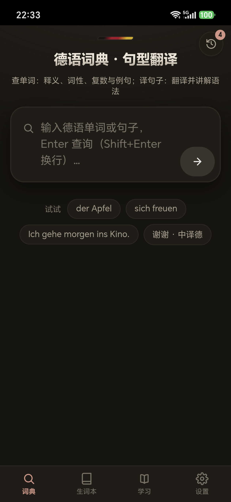
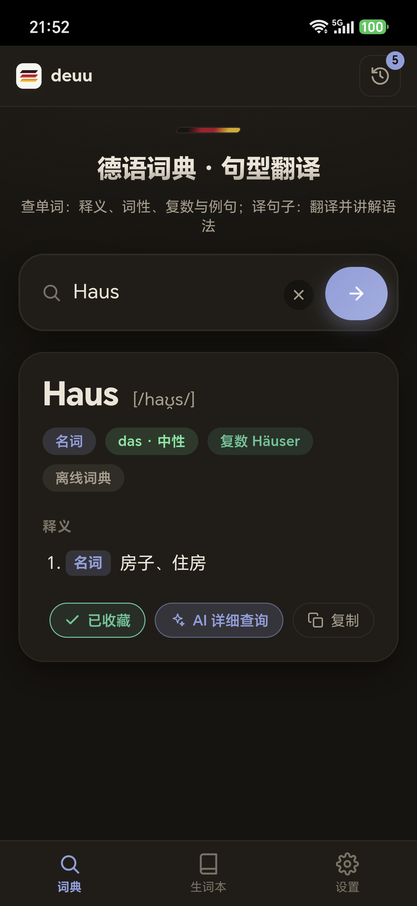
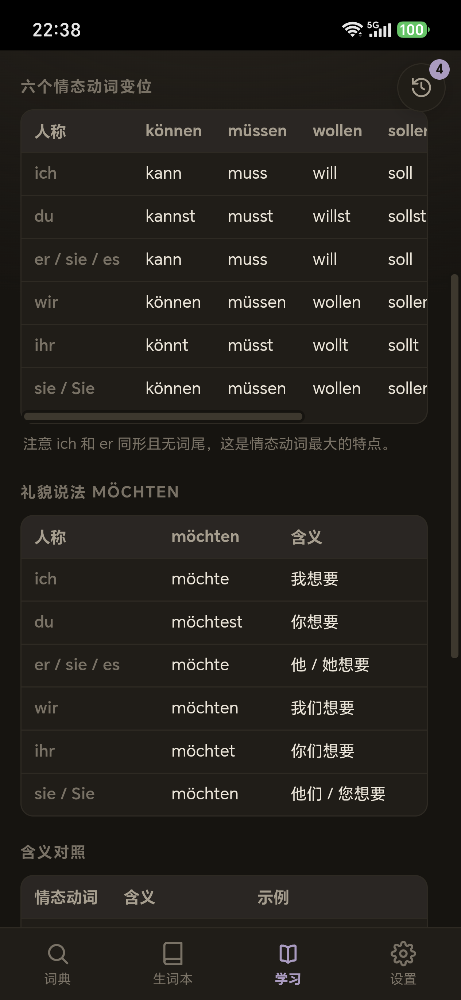
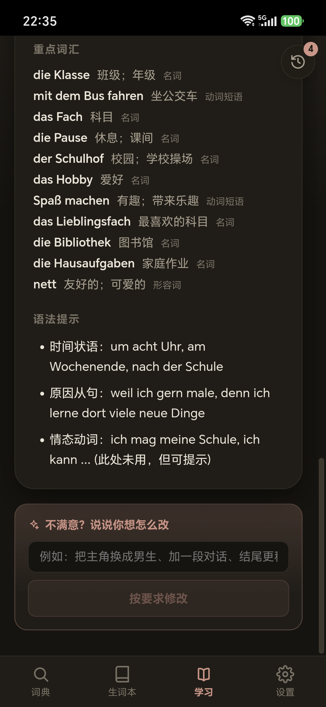

# deuu

一个极简的德语学习应用：**一个输入框，搞定查词、翻译、语法和阅读**。

> 作者：CruelBooch · 许可证：MIT



## 它解决什么问题

查一个德语单词通常要：打开网页 → 忍受广告 → 发现中文释义不全 → 还得另找地方看词性和复数。
deuu 把这些收进一个输入框：**单词查词典，句子翻译并讲语法**，界面只有它需要的东西。

## 功能

| 模块 | 说明 |
|---|---|
| **词典 · 翻译** | 单一输入框自动判断意图：单词返回词性、阴阳中性、复数、音标、释义与例句；句子返回翻译 + 逐点语法讲解 |
| **离线词典** | 内置 20,013 条德语词条（约 2 MB），断网可查，**不消耗任何 API** |
| **生词本** | 收藏、自定义分组、批量删除、拖拽排序 |
| **语法手册** | 28 个语法点（A1–C1），含变位表、变格表与对照表，完全离线 |
| **阅读生成** | 按 CEFR 难度、目标词数、主题生成德语短文，带逐段中文、重点词汇、语法提示；可再用自然语言要求反复修改 |
| **历史记录** | 按时间分组、单条删除、一键复制 |

<p align="center">
  
  
  
</p>

## 平台

| 平台 | 形态 | 说明 |
|---|---|---|
| Windows | Electron 33 | 安装包 / 便携版 / 解压即用 |
| Android | Capacitor 6 | 承载同一套 React UI，侧载 APK |

业务逻辑集中在 `src/core/`（纯 TypeScript，不含任何平台 API），
桌面端与移动端通过 `src/renderer/src/platform/` 的适配层共用同一份界面。

## 技术栈

- Electron 33 + electron-vite 2 + TypeScript + React 18
- Capacitor 6（Android）
- OpenAI 兼容的 Chat Completions 接口：DeepSeek / OpenAI / 通义 / 智谱 等，填 Base URL + Key + 模型名即可
- 无原生模块依赖（不需要 MSVC / node-gyp），词典用紧凑 JSONL + 内存索引

## 目录结构

```
src/
├── core/                 纯业务逻辑：AI 解析、词典索引、语法手册、文章生成
├── main/                 桌面主进程：窗口、设置、历史、生词本、IPC
├── preload/              contextBridge 安全桥接（window.api）
├── renderer/             React 界面（桌面与移动端共用）
│   └── src/platform/     平台适配层（Electron / Capacitor）
└── shared/               主进程与渲染进程共享的类型
dict/                     离线词典数据（JSONL）
scripts/                  词典构建、纯净性检查、发行同步
android/                  Capacitor Android 工程
docs/                     平台方案、架构说明、截图
```

## 开发

```bash
pnpm install --node-linker=hoisted   # 本仓库使用扁平依赖
pnpm dev                             # 开发模式（热更新）
pnpm typecheck                       # 类型检查
pnpm check:core                      # 校验 core 不依赖任何平台 API
pnpm package:win                     # 构建 + 打包 Windows（较慢，发版时用）
pnpm publish                         # 把打包产物同步到发行目录
```

首次使用：打开应用 →「设置」→ 填入 API Key（Base URL 与模型名默认已填好）。

## 构建 Android

需要 JDK 17 + Android SDK，详见 [docs/ANDROID-PLAN.md](docs/ANDROID-PLAN.md)。

```bash
pnpm build
npx cap sync android
cd android && ./gradlew assembleRelease
```

> 签名配置 `android/keystore.properties` 不入库，需自备。

## 关于成本

单词查询完全走离线词典，**零 API 消耗**。只有句子翻译、AI 详查和阅读生成才会调用接口。

以 100 名学生、主要在周末使用为例，DeepSeek 的月费用约 **¥1.4**（空闲时段半价）。

## 架构说明

跨平台的契约与新增平台的方法见 [docs/PLATFORM.md](docs/PLATFORM.md)。

## 许可

[MIT](LICENSE) © CruelBooch
